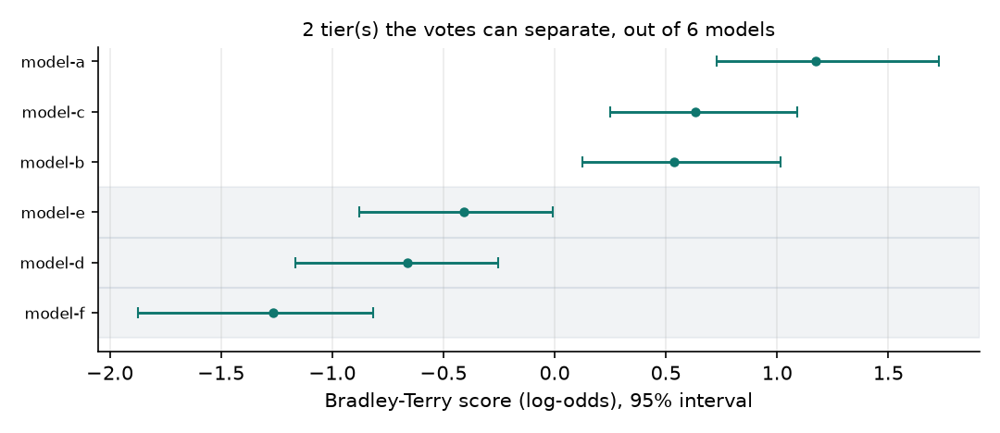
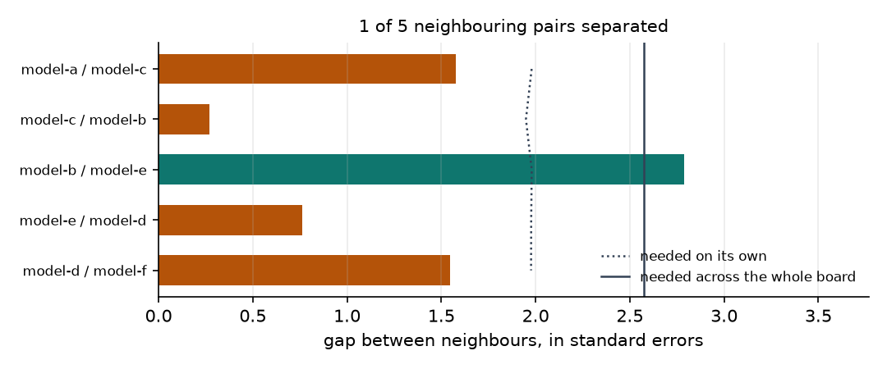

<div align="center">

# arenakit

[](https://github.com/mohammadi-hadi/arenakit/actions/workflows/ci.yml)
[](https://pypi.org/project/arenakit/)
[](https://doi.org/10.5281/zenodo.21813309)
[](https://www.python.org/downloads/)
[](LICENSE)

*Bradley-Terry leaderboards with simultaneous confidence control.*

</div>

Arena leaderboards turn pairwise votes into a ranked list, and the ranked list
is what everyone reads. But a rank is a claim, and the votes behind it support
some of those claims and not others. Two models a hair apart may be genuinely
tied. Being shown first may be worth more than the gap between neighbours. A
board can look decisive because a handful of people voted a great many times.
arenakit takes the votes, fits the same Bradley-Terry model the leaderboards
use, and reports which parts of the published order the evidence actually
carries — with an interval on every number and a flag only when the evidence
clears a stated bar.

## The audit in one table

Nine synthetic boards, one planted defect each. Every probe in the package has
a board here that makes it fire, and the clean board fires nothing.

<!-- arenakit:demo -->
| Board | What was planted | Probes that fired |
| --- | --- | --- |
| Even board | Enough votes, spread evenly, no artefacts planted. | none |
| Too few votes | The same board on 200 votes instead of 6000. | `rank_volatility`, `separation` |
| First slot favoured | Being shown first is worth real odds, and one model takes that slot almost always. | `position_bias`, `position_reordering` |
| Draw-prone model | One weak model draws most of its battles, and half a win each is generous. | `tie_convention` |
| Rock, paper, scissors | Three models beat each other in a circle, which no single strength explains. | `intransitivity` |
| Two separate pools | Two halves of the board that never met, ranked as though they had. | `connectivity` |
| Lopsided budget | The comparison budget is spent mostly on the models at the top. | `coverage_imbalance` |
| A few power voters | Six people with strong tastes cast a third of all votes. | `separation`, `vote_clustering` |
| One loud annotator | Two equally good models, and one annotator with a firm view about them. | `annotator_influence`, `separation`, `vote_clustering` |
<!-- /arenakit:demo -->





The two figures are the same thin board seen two ways: on the left of each, six
models whose intervals overlap into two tiers; on the right, the gap between
each pair of neighbours measured against the evidence needed to call it real —
once on its own, and once with the whole board's worth of comparisons taken into
account.

`make results` regenerates the table, the [full report](results/report.md) and
the figures from fixed seeds. CI rebuilds them from pinned dependencies and
fails if a committed number differs from what the code produces.

## 106,134 real arena votes, audited

[`examples/lmarena/`](examples/lmarena/) audits the public
[LMArena preference sample](https://huggingface.co/datasets/lmarena-ai/arena-human-preference-100k):
106,134 human votes over 55 models. Committed results:
[examples/lmarena/results/lmarena.md](examples/lmarena/results/lmarena.md).

- **1 of 54 neighbouring pairs is separated** once the 54 comparisons are
  controlled for together; 5 are separated judged one at a time. Only the top
  model is distinguishable from its neighbour. The other 54 models form a
  single block the votes cannot order — which is not the same as saying the
  order is wrong, only that these votes do not establish it.
- **Closing the median unresolved gap would take roughly 8.9 million votes** at
  this design, against the 106 thousand collected. For most neighbouring pairs
  the honest reading is that they are tied.
- **The median model's 95% rank interval spans 7 ranks**, and
  `gemma-2-9b-it-simpo` — 468 battles — spans 16.
- **Position matters, and it does not matter.** The model shown first wins
  49.53% of 65,418 decisive battles. The interval on the fitted advantage,
  [-0.021, -0.001] in log-odds, excludes zero, so at this sample size the effect
  is real. The whole interval also sits inside the +/-0.05 band this package
  treats as immaterial, and fitting the advantage out reorders nothing.
  Detectable and worth acting on are different questions, and a leaderboard
  needs an answer to the second one.
- **Clustering the bootstrap on voters widens standard errors by 1.03x.** The
  busiest 1% of the 49,382 voters cast 16% of all votes, so the concern is
  well founded, but on this data the usual battle-level bootstrap is close
  enough. That is a finding, not an assumption — and it is the kind of thing
  worth checking rather than asserting either way.
- **38.4% of votes are ties**, and the ranking survives dropping them or
  modelling them (Rao-Kupper theta 2.35) instead of splitting them.
- **Preference cycles land about where Bradley-Terry expects**: 3.5% of the
  14,164 decided triads are cyclic against 4.3% predicted. One strength per
  model is enough to describe who beats whom on this board.

## The same six models, judged by people and by GPT-4

[`examples/mtbench/`](examples/mtbench/) audits both halves of
[MT-Bench's judgments](https://huggingface.co/datasets/lmsys/mt_bench_human_judgments):
3,355 votes from 65 people, and 2,400 verdicts from GPT-4 acting as a judge, on
the same models and the same questions. Committed results:
[examples/mtbench/results/mtbench.md](examples/mtbench/results/mtbench.md).

- **GPT-4 changes its mind on 15.8% of pairs when the two answers swap places.**
  That figure is not estimated here; the split records those cases explicitly,
  because it was collected by asking both ways round.
- **GPT-4 matches the human majority on 71.3%** of the 1,612 comparisons where
  the humans reached one.
- **And it produces exactly the human leaderboard.** Kendall tau between the
  two orders is +1.00. Judge noise that looks disqualifying one comparison at a
  time averages out of a six-model ranking — which is a reason to be careful
  about what a leaderboard proves, in both directions.
- The judge's verdicts are correlated within question: resampling questions
  rather than verdicts widens its intervals by 1.48x. The human votes, spread
  over 65 annotators, show no annotator carrying the board.

## Install

```bash
pip install arenakit
```

Python 3.11+. Runtime dependencies are numpy, pydantic and matplotlib. The two
case studies additionally need `pyarrow` to read the published parquet files.

## Quickstart

```bash
arenakit audit battles.csv
```

where `battles.csv` has `model_a`, `model_b`, `winner`, and optionally
`item_id` and `voter_id`. `model_a` is the model shown **first**.

```python
from arenakit import Arena, load_battles, run_audit

audit = run_audit(Arena(load_battles("battles.csv")))

for row in audit.leaderboard[:5]:
    print(row["rank"], row["model"], row["score"], row["rank_ci"])

for probe in audit.triggered:
    print(probe.name, "-", probe.reason)
```

Fitting on its own, without the audit:

```python
from arenakit import fit_bt, to_elo

fit = fit_bt(arena.counts(), ties="half", order=True)
print(fit.order_log)      # advantage of being shown first, in log-odds
print(to_elo(fit.scores)) # the same scores in the usual leaderboard units
```

## What it checks

| Probe | Question | Flags when |
| --- | --- | --- |
| `separation` | How much of the published order do the votes support? | more than a quarter of neighbouring pairs are not separated |
| `rank_volatility` | How far does each rank move under resampling? | the median rank interval spans more than 2 ranks |
| `connectivity` | Are the scores comparable at all? | the board splits into groups that never met, or a model has under 30 battles |
| `coverage_imbalance` | Was the comparison budget spent evenly? | Gini of battles per model above 0.5 |
| `position_bias` | Is being shown first worth anything? | the advantage clears 0.05 in log-odds |
| `position_reordering` | Does correcting for position change the order? | any separated pair reverses |
| `tie_convention` | Does the order survive a different tie rule? | any separated pair reverses under dropped or modelled ties |
| `intransitivity` | Can one strength per model explain who beats whom? | cycles exceed what the fit predicts by 2 points |
| `vote_clustering` | Was independent resampling ever justified? | clustered standard errors are more than 1.15x wider |
| `annotator_influence` | Is one annotator moving the board? | dropping one shifts a model by a whole rung of the ladder |

Thresholds are named constants in
[`src/arenakit/probes.py`](src/arenakit/probes.py); the table above is a
description of that file, not a second source of truth. A probe that cannot
answer its question says so and skips — for instance, the position probes stand
down when the data records which model *sorts* first rather than which was
*shown* first, which is exactly what MT-Bench's GPT-4 split does.

## How the numbers are defended

- **Separation is not interval overlap.** Two intervals can overlap while the
  difference between them is significant, so the overlap rule quietly calls
  real gaps unresolved. arenakit takes the bootstrap distribution of the
  *difference*, studentises it, and compares it against a critical value. There
  is a test that constructs a board where the two rules disagree.
- **A leaderboard makes every comparison at once.** Ranking 55 models means 54
  adjacent tests chosen by the same data that will judge them, so `separation`
  reports both a marginal verdict and a simultaneous one using a max-t critical
  value across the whole board. On the arena data the two answers are 5 and 1.
- **The fits are checked against a reference implementation.** Bradley-Terry is
  logistic regression on signed model indicators, and the first-position term is
  its intercept; both are asserted equal to `statsmodels` to 1e-5. Two-model
  boards are checked against the closed form, and Rao-Kupper is checked to
  collapse onto plain Bradley-Terry when there are no ties.
- **Every probe has a board built to make it fire.** `make results` audits nine
  planted boards and asserts the exact set of flags each one raises, so a probe
  that becomes over-eager shows up as a clean board raising a flag, and one that
  goes blind shows up as a planted defect nobody noticed.
- **Reruns are identical.** One seed, fixed convergence tolerance and iteration
  cap, integer matrix products where a count has to be exact, and no BLAS in any
  path that produces a published number.

## Design notes

**Sufficient statistics, not battle lists.** Every model here is fitted from a
matrix of ordered pair counts, which is all the likelihood depends on. A
bootstrap resample therefore costs three weighted `bincount` calls plus an
iteration on a 55x55 matrix, and two thousand resamples over a hundred thousand
battles take seconds rather than an afternoon.

**The default resampling is the most conservative the data allows** — voters if
they are recorded, then prompts, then battles — because treating correlated
votes as independent is the commoner mistake and the quieter one. When the
chosen column has too few distinct values to resample, the audit drops to a
coarser scheme and says so, rather than reporting the zero-width intervals a
one-annotator resample would produce.

**Disconnected boards are refused, not fudged.** Two models joined by no chain
of opponents have no estimable difference; the likelihood is flat in exactly
that direction, and any number printed for the gap comes from the prior.
`run_audit` keeps the largest connected group, reports what it dropped, and
`fit_bt` raises rather than returning a number nobody should use.

**Ties arrive as one outcome on purpose.** Real boards ship richer tie labels —
"both bad", "both good", "inconsistent" — and collapsing them changes the
ranking, so the loader refuses to guess and asks you to map them yourself. Both
case studies show the mapping in their source.

**A weak prior, so the fit always exists.** Each model plays half a virtual
battle against an average opponent, which keeps an undefeated model's score
finite. With `prior=0.0` you get the unpenalised estimate, and a clear error
when it does not exist.

## Limitations

- **Which pairs are adjacent is decided by the point estimate.** The
  simultaneous test controls the family-wise error rate across those 54
  comparisons, but the comparisons themselves were chosen after seeing the data.
  A fully simultaneous treatment of the ranking would be more conservative
  still, so the separation counts here are, if anything, generous.
- **Bradley-Terry assumes one number per model.** `intransitivity` checks that
  assumption but does not repair it; a board with genuine rock-paper-scissors
  structure needs a different model, not a wider interval.
- **Half-credit ties are a convention, not a likelihood.** With `ties="half"`
  the fit maximises a weighted objective rather than a probability model.
  `fit_rao_kupper` gives ties a parameter instead, and `tie_convention` reports
  whether the choice mattered.
- **The position term is one number for the whole board.** A judge that favours
  the first slot only for long answers, or only in one language, will not show
  up as a single advantage.
- **The case studies are public samples, not the live leaderboards.** The
  LMArena file is a 106k-battle release covering 55 models, not the full vote
  history behind the published board.

## Related work

- Bradley and Terry (1952), *Rank Analysis of Incomplete Block Designs*
  ([doi:10.2307/2334029](https://doi.org/10.2307/2334029)) — the model.
- Rao and Kupper (1967), *Ties in Paired-Comparison Experiments*
  ([doi:10.1080/01621459.1967.10482901](https://doi.org/10.1080/01621459.1967.10482901))
  — the tie model used here.
- Hunter (2004), *MM algorithms for generalized Bradley-Terry models*
  ([doi:10.1214/aos/1079120141](https://doi.org/10.1214/aos/1079120141)) — the
  fitting algorithm, including the position and tie extensions.
- Ford (1957), *Solution of a Ranking Problem from Binary Comparisons*
  ([doi:10.2307/2308513](https://doi.org/10.2307/2308513)) — when a finite
  estimate exists at all.
- Chiang et al. (2024), *Chatbot Arena: An Open Platform for Evaluating LLMs by
  Human Preference* ([arXiv:2403.04132](https://arxiv.org/abs/2403.04132)) —
  the leaderboard this package audits.
- Zheng et al. (2023), *Judging LLM-as-a-Judge with MT-Bench and Chatbot Arena*
  ([arXiv:2306.05685](https://arxiv.org/abs/2306.05685)) — the source of the
  human and GPT-4 judgments, and of the position-bias measurement.
- Westfall and Young (1993), *Resampling-Based Multiple Testing* — the max-t
  idea behind the simultaneous critical value.

## Companion projects

- [judgekit](https://github.com/mohammadi-hadi/judgekit) — bias probes for LLM
  judges, each with a bootstrap confidence interval.
- [judgepanel](https://github.com/mohammadi-hadi/judgepanel) — estimate judge
  accuracy without gold labels.
- [raterkit](https://github.com/mohammadi-hadi/raterkit) — reliability,
  rogue-rater, drift and leakage diagnostics for labelled data.
- [calikit](https://github.com/mohammadi-hadi/calikit) — reliability diagrams,
  ECE and Brier decomposition for a model's probabilities.
- [abkit](https://github.com/mohammadi-hadi/abkit) — sample-ratio, peeking,
  multiple-testing and winner's-curse checks for experiment readouts.

## Citation

```bibtex
@software{mohammadi_arenakit,
  author  = {Mohammadi, Hadi},
  title   = {arenakit: audit a pairwise model leaderboard before you trust its order},
  year    = {2026},
  doi     = {10.5281/zenodo.21813309},
  url     = {https://github.com/mohammadi-hadi/arenakit}
}
```

## License

MIT
